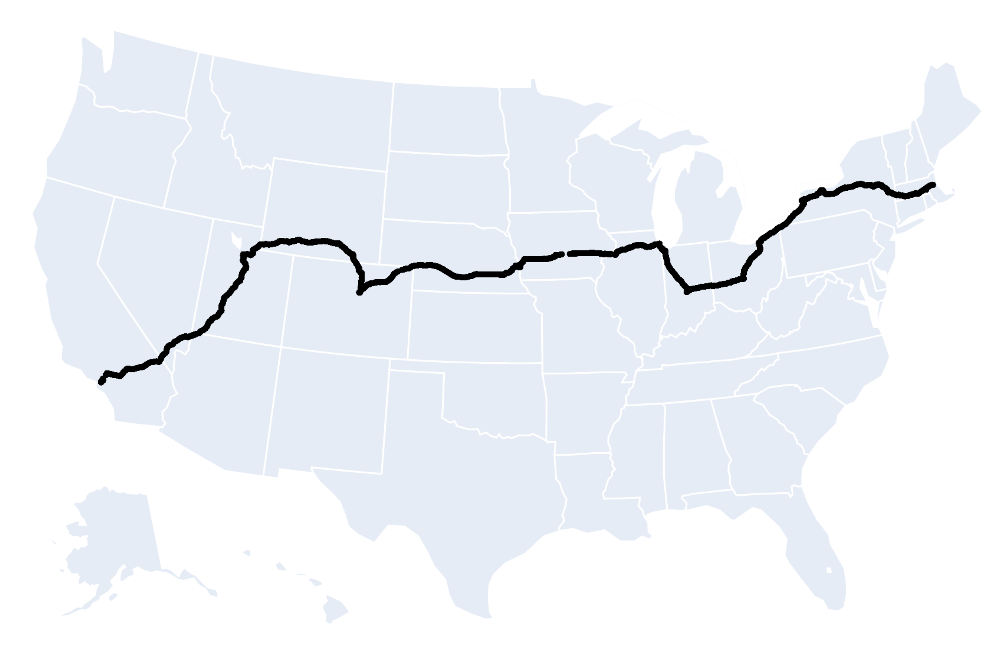

# [CoNEXT '26] A Cross-Country Measurement Study of Inter-cell Interference in Cellular Networks

In this repository, we release the dataset and scripts used in the CoNEXT '26 paper, *A Cross-Country Measurement Study of Inter-cell Interference in Cellular Networks*

<p align="center">

</p>

**Authors**:
[[Zhekun Yu](https://www.linkedin.com/in/zhekun-yu-444a962a8/)]
[[Yufei Feng](https://www.linkedin.com/in/yufei-feng-7b268820b)]
[[Moinak Ghoshal](https://sites.google.com/view/moinak-ghoshal/home)] 
[[Omar Basit](https://scholar.google.com/citations?user=O8YhcToAAAAJ&hl=en)]
[[Imran Khan](https://imranbuet63.github.io)]
[[Z. Jonny Kong](https://www.jonnykong.com)]
[[Sizhe Wang](https://sizhewang.cn)]
[[Phuc Dinh](https://scholar.google.com/citations?user=87M0_7EAAAAJ&hl=en)]
[[Y. Charlie Hu](https://engineering.purdue.edu/~ychu/)]
[[Dimitrios Koutsonikolas](https://ece.northeastern.edu/fac-ece/dkoutsonikolas/)]


## Repository Structure

| Directory | Contents |
| --- | --- |
| `data/raw_data/` | Origianl XCAL measurement data including RF metrics and LTE-neighbor logs; application downlink logs |
| `data/intermediate_data/` | Intermediate processed data for plotting |
| `scripts/data_cleaning/` | Data preparation scripts |
| `scripts/plotting/` | Plotting scripts |
| `plots/` | Final paper parsed/visualized results as PDFs |


## Data Access

Use the following command to download large dataset files stored with Git LFS:
```bash
git lfs pull
```

## Usage

- **`plotting`** 
Install the Python dependencies with `python -m pip install -r requirements.txt`, then run `python scripts/plotting/plot_all.py` from the repository root to regenerate every figure PDF in `plots/`.  Use `python scripts/plotting/plot_all.py --list` to see the execution order. Or run single script `python scripts/plotting/fig_[*].py` to generate corresponding figure  in paper.

- **`2024 data cleaning`**
Run `python scripts/data_cleaning/run_all_2024.py` to parse raw XCAL data, build the combined UE-level CSV, parse LTE neighboring-cell logs, and rebuild application reports from the raw downlink logs. Run with `--list` to see its steps without processing data. Results are saved in `data/intermediate_data/`.

- **`2022 data cleaning`**
Run `python scripts/data_cleaning/run_all_2022.py` to split raw XCAL runs by operator, build per-cell reports, and parse LTE neighboring-cell logs. Results are saved in `data/intermediate_data/`.

---

If there are any questions, feel free to contact us  
([yu.zheku@northeastern.edu](mailto:yu.zheku@northeastern.edu)).


